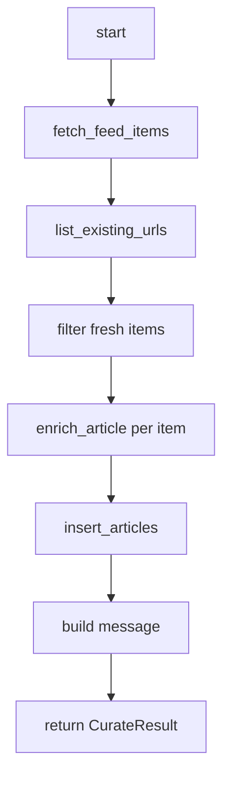

# ニュースデスク プログラム設計書（バックエンド）

| 項目 | 内容 |
|------|------|
| 文書名 | プログラム設計書（バックエンド） |
| 対象システム | ニュースデスク（RSS キュレーションアプリ） |
| 版 | 0.1.0 |
| 根拠ソース | `backend/` 現行実装 |
| 作成日 | 2026-10-15 |
| 関連 | [プログラム設計書（索引）](./プログラム設計書.md)、[プログラム設計書（フロントエンド）](./プログラム設計書_フロントエンド.md)、[基本設計書](./基本設計書.md)、[詳細設計書](./詳細設計書.md) |

---

## 1. はじめに

### 1.1 目的

本書類は、バックエンド（`backend/`）について、詳細設計を関数・処理単位まで落としたプログラム設計である。シグネチャ、入出力、分岐、アルゴリズム、例外、定数を定義する。

### 1.2 対象範囲

- `backend/app/**/*.py`

### 1.3 記述形式

各関数は次の項目で記載する。

- ファイル
- シグネチャ
- 入力 / 出力
- 処理手順
- 分岐・例外
- 依存

---

## 2. モジュール一覧

| モジュール | パス | 責務 |
|------------|------|------|
| config | `backend/app/config.py` | 環境変数の読込 |
| main | `backend/app/main.py` | FastAPI アプリ生成、CORS、`/health` |
| jobs | `backend/app/routers/jobs.py` | キュレート API |
| curate | `backend/app/services/curate.py` | パイプライン制御 |
| rss | `backend/app/services/rss.py` | RSS 取得・パース |
| ai | `backend/app/services/ai.py` | 要約・重要度 |
| supabase_writer | `backend/app/services/supabase_writer.py` | Supabase 書込 |

---

## 3. `config.py`

#### クラス `Settings`

- ファイル: `backend/app/config.py`
- 基底: `pydantic_settings.BaseSettings`
- 設定:
  - `env_file=".env"`
  - `env_file_encoding="utf-8"`
  - `extra="ignore"`

| フィールド | 型 | 既定値 | 環境変数 |
|------------|-----|--------|----------|
| `supabase_url` | str | `""` | `SUPABASE_URL` |
| `supabase_service_role_key` | str | `""` | `SUPABASE_SERVICE_ROLE_KEY` |
| `openai_api_key` | str | `""` | `OPENAI_API_KEY` |
| `openai_model` | str | `"gpt-4o-mini"` | `OPENAI_MODEL` |
| `cors_origins` | str | `"http://localhost:3000"` | `CORS_ORIGINS` |

#### プロパティ `cors_origin_list`

- シグネチャ: `-> list[str]`
- 処理手順:
  1. `cors_origins` をカンマ分割する
  2. 各要素を `strip()` し、空文字を除く
- 出力: 許可オリジンのリスト

#### プロパティ `is_supabase_configured`

- シグネチャ: `-> bool`
- 処理手順: `supabase_url` と `supabase_service_role_key` がともに truthy なら `True`

#### プロパティ `is_openai_configured`

- シグネチャ: `-> bool`
- 処理手順: `openai_api_key.strip()` が空でなければ `True`

#### 関数 `get_settings`

- シグネチャ: `() -> Settings`
- 処理手順: `@lru_cache` 付きで `Settings()` を1回生成し再利用する
- 依存: `Settings`

---

## 4. `main.py`

#### アプリ初期化

- ファイル: `backend/app/main.py`
- 処理手順:
  1. `get_settings()` で設定を取得する
  2. `FastAPI(title="ニュースデスク API", version="0.1.0", ...)` を生成する
  3. `CORSMiddleware` を追加する
     - `allow_origins`: `settings.cors_origin_list` が空なら `["http://localhost:3000"]`
     - `allow_credentials=True`
     - `allow_methods=["*"]`
     - `allow_headers=["*"]`
  4. `jobs.router` を `include_router` する

#### 関数 `health`

- シグネチャ: `() -> dict[str, object]`
- ルート: `GET /health`
- 出力:

| キー | 型 | 内容 |
|------|-----|------|
| `status` | str | 常に `"ok"` |
| `supabase_configured` | bool | `settings.is_supabase_configured` |
| `openai_configured` | bool | `settings.is_openai_configured` |
| `openai_model` | str | `settings.openai_model` |

- 依存: `get_settings`

---

## 5. `routers/jobs.py`

#### 型 `CurateRequest`

| フィールド | 型 | 必須 | 説明 |
|------------|----|------|------|
| `topic_id` | str | ○ | Supabase `topics.id` |
| `feed_url` | str | ○ | RSS / Atom URL |

#### 型 `CurateResponse`

| フィールド | 型 | 説明 |
|------------|-----|------|
| `fetched` | int | RSS 取得件数 |
| `new_items` | int | 新規件数 |
| `inserted` | int | INSERT 件数 |
| `message` | str | 結果メッセージ |

#### 関数 `curate_now`

- ファイル: `backend/app/routers/jobs.py`
- シグネチャ: `(body: CurateRequest) -> CurateResponse`
- ルート: `POST /jobs/curate`
- 処理手順:
  1. `run_curation(topic_id=body.topic_id, feed_url=body.feed_url)` を呼ぶ
  2. 戻り値を `CurateResponse` に写して返す
- 分岐・例外:

| 例外 | HTTP | detail |
|------|------|--------|
| `FeedFetchError` | 502 | `str(exc)` |
| `SupabaseWriterError` | 502 | `str(exc)` |
| バリデーション失敗 | 422 | FastAPI 標準 |

- 依存: `run_curation`, `FeedFetchError`, `SupabaseWriterError`

---

## 6. `services/curate.py`

#### 型 `CurateResult`

| フィールド | 型 |
|------------|-----|
| `fetched` | int |
| `new_items` | int |
| `inserted` | int |
| `message` | str |

#### 関数 `run_curation`

- ファイル: `backend/app/services/curate.py`
- シグネチャ: `(topic_id: str, feed_url: str) -> CurateResult`
- 入力: トピック ID、フィード URL
- 出力: 件数とメッセージ

- 処理手順:
  1. `items = rss.fetch_feed_items(feed_url)`
  2. `existing = supabase_writer.list_existing_urls(topic_id)`
  3. `fresh = [item for item in items if item.url not in existing]`
  4. `ai_count = 0`、`drafts = []`
  5. 各 `item in fresh` について:
     - `enrichment = ai.enrich_article(item.title, item.raw_summary)`
     - `used_ai` が真なら `ai_count += 1`
     - `ArticleDraft(topic_id, title, url, summary, importance, published_at)` を `drafts` に追加
  6. `inserted = supabase_writer.insert_articles(drafts)`
  7. メッセージ生成:
     - `fresh` があり `ai_count == 0` のとき: AI 未使用である旨を付記
     - それ以外: `AI 要約 {ai_count} 件。` を付記
  8. `CurateResult(fetched=len(items), new_items=len(fresh), inserted=inserted, message=...)` を返す
- 分岐・例外: `fetch_feed_items` / `insert_articles` の例外は上位へ伝播する
- 依存: `rss`, `ai`, `supabase_writer`

---

## 7. `services/rss.py`

#### 定数

| 名前 | 値 |
|------|-----|
| `_USER_AGENT` | `RSS-App-Curation/0.1 (+https://localhost; feed fetcher)` |
| `_TAG_RE` | HTML タグ除去用正規表現 |

#### 型 `FeedItem`

| フィールド | 型 | 説明 |
|------------|-----|------|
| `title` | str | タイトル |
| `url` | str | 記事 URL |
| `published_at` | str \| None | UTC ISO 8601 |
| `raw_summary` | str \| None | RSS 上の説明文 |

#### 例外 `FeedFetchError`

RSS 取得・解析失敗時に送出する。

#### 関数 `fetch_feed_items`

- シグネチャ: `(feed_url: str, *, timeout: float = 20.0) -> list[FeedItem]`
- 処理手順:
  1. `feed_url` を `strip()`。空なら `FeedFetchError`
  2. `httpx.get`（`follow_redirects=True`、指定 timeout、Accept / User-Agent ヘッダ）
  3. `raise_for_status()`。`httpx.HTTPError` は `FeedFetchError` に変換
  4. `feedparser.parse(response.content)`
  5. `entries` が空なら `FeedFetchError`（`bozo_exception` があれば付記）
  6. 各 entry を `_entry_to_item` で変換。`None` または URL 重複はスキップ
  7. 有効件数が 0 なら `FeedFetchError`
  8. `list[FeedItem]` を返す
- 依存: `httpx`, `feedparser`, 内部関数群

#### 関数 `_entry_to_item`

- シグネチャ: `(entry: Any) -> FeedItem | None`
- 処理手順:
  1. `title = _clean_text(entry.title)`、`link = _clean_text(entry.link)`
  2. どちらか欠ける場合は `None`
  3. `summary` は `entry.summary` または `entry.description` を `_clean_text`
  4. `published_at = _resolve_published_at(entry)`
  5. `FeedItem` を返す

#### 関数 `_resolve_published_at`

- シグネチャ: `(entry: Any) -> str | None`
- 処理手順:
  1. `published_parsed` / `updated_parsed` を順に `_struct_time_to_iso`
  2. だめなら `published` / `updated` 文字列を `_raw_date_to_iso`
  3. いずれも失敗なら `None`

#### 関数 `_struct_time_to_iso`

- シグネチャ: `(value: Any) -> str | None`
- 処理手順: `struct_time` でなければ `None`。UTC の `datetime` を組み立て `isoformat()`。例外時 `None`

#### 関数 `_raw_date_to_iso`

- シグネチャ: `(value: Any) -> str | None`
- 処理手順: 非空文字列を `parsedate_to_datetime`。tzinfo が無ければ UTC を付与し、UTC へ変換して `isoformat()`。例外時 `None`

#### 関数 `_clean_text`

- シグネチャ: `(value: Any) -> str | None`
- 処理手順:
  1. 文字列でなければ `None`
  2. HTML タグ除去
  3. 空白正規化（連続空白を1つに）
  4. 空なら `None`、それ以外は 文字列を返す

---

## 8. `services/ai.py`

#### 定数

| 名前 | 値 |
|------|-----|
| `_OPENAI_URL` | `https://api.openai.com/v1/chat/completions` |
| `_MAX_INPUT_CHARS` | 4000 |
| `_MAX_SUMMARY_CHARS` | 280 |
| `_SYSTEM_PROMPT` | JSON のみ返す日本語編集指示（summary / importance） |

#### 型 `ArticleEnrichment`

| フィールド | 型 | 説明 |
|------------|-----|------|
| `summary` | str \| None | 要約 |
| `importance` | str | `high` / `medium` / `low` |
| `used_ai` | bool | OpenAI 成功時 `True` |

#### 関数 `enrich_article`

- シグネチャ: `(title: str, content: str | None = None, settings: Settings | None = None) -> ArticleEnrichment`
- 処理手順:
  1. `settings` 未指定時は `get_settings()`
  2. `title` を trim。空なら `"無題"`
  3. `content` を trim。空なら `None`
  4. OpenAI 未設定なら `_fallback(..., used_ai=False)`
  5. 設定ありなら `_enrich_with_openai` を試行。例外時は警告ログのうえ `_fallback(..., used_ai=False)`
- 依存: `get_settings`, OpenAI 系内部関数

#### 関数 `normalize_importance`

- シグネチャ: `(value: str | None) -> str`
- 分岐表:

| 入力（正規化後） | 出力 |
|------------------|------|
| `high`, `高`, `高い`, `重要` | `high` |
| `medium`, `mid`, `中`, `中程度`, `普通` | `medium` |
| `low`, `低`, `低い` | `low` |
| 文字列に `high` / `critical` を含む | `high` |
| 文字列に `medium` / `moderate` を含む | `medium` |
| その他 | `low` |

処理前に `strip().lower()` する。

#### 関数 `_enrich_with_openai`

- シグネチャ: `(title: str, content: str | None, settings: Settings) -> ArticleEnrichment`
- 処理手順:
  1. 本文が無ければ固定文言を user プロンプトに使う
  2. 本文は先頭 `_MAX_INPUT_CHARS` 文字に制限
  3. Chat Completions を POST（model / temperature=0.2 / `response_format=json_object`）
  4. 応答本文を `_extract_message_text` → `_parse_json_object`
  5. `summary` を `_clip_summary`。空なら `_fallback_summary`
  6. `importance` を `normalize_importance`
  7. `used_ai=True` の `ArticleEnrichment` を返す
- 分岐・例外: HTTP / JSON 失敗は呼び出し元で捕捉

#### 関数 `_extract_message_text`

- シグネチャ: `(data: dict[str, Any]) -> str`
- 処理手順: `choices[0].message.content` を取得。list の場合は `text` を結合。空なら `ValueError`

#### 関数 `_parse_json_object`

- シグネチャ: `(text: str) -> dict[str, Any]`
- 処理手順:
  1. `json.loads` で dict なら返す
  2. 失敗時は正規表現で `{...}` を抽出し再パース
  3. dict でなければ `ValueError`

#### 関数 `_fallback`

- シグネチャ: `(title, content, *, used_ai: bool) -> ArticleEnrichment`
- 出力: `summary=_fallback_summary(...)`, `importance="low"`, 指定の `used_ai`

#### 関数 `_fallback_summary`

- シグネチャ: `(title: str, content: str | None) -> str`
- 処理手順: content があればそれを `_clip_summary`、なければ title を `_clip_summary`（結果が空なら title）

#### 関数 `_clip_summary`

- シグネチャ: `(text: str | None) -> str | None`
- 処理手順: 空白正規化後、長さが `_MAX_SUMMARY_CHARS` 超なら切り詰めて末尾に `…`

---

## 9. `services/supabase_writer.py`

#### 定数

| 名前 | 値 |
|------|-----|
| `_PAGE_SIZE` | 1000 |

#### 型 `ArticleDraft`

| フィールド | 型 |
|------------|-----|
| `topic_id` | str |
| `title` | str |
| `url` | str |
| `summary` | str \| None |
| `importance` | str \| None |
| `published_at` | str \| None |

#### 例外 `SupabaseWriterError`

クライアント未設定・書込失敗時に送出する。

#### 関数 `_cached_client`

- シグネチャ: `(url: str, key: str) -> Client`
- 処理手順: `@lru_cache` で `create_client(url, key)` をキャッシュ

#### 関数 `get_client`

- シグネチャ: `(settings: Settings | None = None) -> Client`
- 処理手順:
  1. 設定取得
  2. `is_supabase_configured` が偽なら `SupabaseWriterError`
  3. `_cached_client(url, key)` を返す

#### 関数 `list_existing_urls`

- シグネチャ: `(topic_id: str, settings: Settings | None = None) -> set[str]`
- 処理手順:
  1. 未設定または `topic_id` 空なら空集合
  2. `offset=0` から `articles` を `select("url").eq("topic_id", topic).range(offset, offset+PAGE_SIZE-1)`
  3. 取得 URL を集合に追加
  4. 取得件数が `_PAGE_SIZE` 未満なら終了、それ以外は `offset` を進めて繰り返す
- 出力: URL の集合

#### 関数 `insert_articles`

- シグネチャ: `(drafts: list[ArticleDraft], settings: Settings | None = None) -> int`
- 処理手順:
  1. 未設定または `drafts` 空なら `0`
  2. 先頭の `topic_id` を基準にし、混在があれば `SupabaseWriterError`
  3. `existing = list_existing_urls(topic_id)`
  4. 各 draft について次を除外: url/title 空、`existing` に含まれる、バッチ内重複
  5. 行データ構築（`is_read=False`、`published_at` は値があるときのみ）
  6. 行が 0 なら `0`
  7. `table("articles").insert(rows).execute()`
  8. 例外時 `SupabaseWriterError`
  9. `len(response.data or [])` を返す
- 依存: `get_client`, `list_existing_urls`

---

---

## 10. 定数一覧

| 定数 | 値 | 場所 |
|------|-----|------|
| RSS HTTP timeout | 20s | `rss.py` |
| OpenAI HTTP timeout | 45s | `ai.py` |
| 入力本文上限 | 4000 | `ai.py` |
| 要約上限 | 280 | `ai.py` |
| URL 一覧ページサイズ | 1000 | `supabase_writer.py` |
| バック開発ポート | 8000 | uvicorn |

---

## 11. 例外・エラー対応表

| 発生元 | 条件 | 伝播 / 表示 |
|--------|------|-------------|
| `rss.fetch_feed_items` | 空 URL / HTTP 失敗 / 解析不能 | `FeedFetchError` → API 502 |
| `ai.enrich_article` | キー無し / API 失敗 | フォールバック、パイプライン継続 |
| `supabase_writer.get_client` | 未設定 | `SupabaseWriterError` |
| `supabase_writer.insert_articles` | トピック混在 / insert 失敗 | `SupabaseWriterError` → API 502 |

---

## 12. 改訂履歴

| 版 | 日付 | 内容 |
|----|------|------|
| 0.1.0 | 2026-10-15 | 統合プログラム設計書からバックエンド分を分割 |
