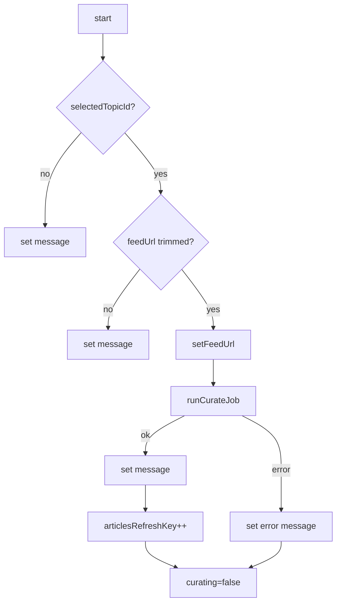

# ニュースデスク プログラム設計書（フロントエンド）

| 項目 | 内容 |
|------|------|
| 文書名 | プログラム設計書（フロントエンド） |
| 対象システム | ニュースデスク（RSS キュレーションアプリ） |
| 版 | 0.1.0 |
| 根拠ソース | `frontend/` 現行実装 |
| 作成日 | 2026-10-15 |
| 関連 | [プログラム設計書（索引）](./プログラム設計書.md)、[プログラム設計書（バックエンド）](./プログラム設計書_バックエンド.md)、[基本設計書](./基本設計書.md)、[詳細設計書](./詳細設計書.md) |

---

## 1. はじめに

### 1.1 目的

本書類は、フロントエンド（`frontend/`）について、詳細設計を関数・処理単位まで落としたプログラム設計である。シグネチャ、入出力、分岐、アルゴリズム、例外、定数を定義する。

### 1.2 対象範囲

- `frontend/app/**`、`frontend/lib/**`、利用する `frontend/components/ui/*`
- shadcn/ui 各コンポーネントの内部実装の再記述は行わず、利用箇所と公開 API のみ記載する

### 1.3 記述形式

各関数は次の項目で記載する。

- ファイル
- シグネチャ
- 入力 / 出力
- 処理手順
- 分岐・例外
- 依存

---

## 2. モジュール一覧

| モジュール | パス | 責務 |
|------------|------|------|
| RootLayout | `frontend/app/layout.tsx` | HTML 骨格・フォント |
| HomePage | `frontend/app/page.tsx` | ダッシュボード UI・状態 |
| supabase client | `frontend/lib/supabase/client.ts` | anon クライアント |
| types | `frontend/lib/supabase/types.ts` | 型・重要度変換 |
| backend | `frontend/lib/backend.ts` | キュレート API 呼出 |
| feed-urls | `frontend/lib/feed-urls.ts` | RSS URL の永続化 |
| UI | `frontend/components/ui/*` | 汎用 UI 部品 |

---

## 3. `lib/supabase/client.ts`

#### 定数 `isSupabaseConfigured`

- 型: `boolean`
- 定義: `NEXT_PUBLIC_SUPABASE_URL` と `NEXT_PUBLIC_SUPABASE_ANON_KEY` がともに truthy

#### 定数 `supabase`

- 型: `SupabaseClient<Database> | null`
- 処理手順:
  - URL と anon key があるとき `createClient<Database>(url, key)`
  - 無いとき `null`

---

## 4. `lib/supabase/types.ts`

#### 型

| 型名 | フィールド |
|------|------------|
| `Topic` | `id`, `name`, `created_at` |
| `Article` | `id`, `topic_id`, `title`, `url`, `summary`, `importance`, `is_read`, `published_at` |
| `ImportanceLevel` | `"high" \| "medium" \| "low"` |
| `Database` | Supabase クライアント用テーブル型定義 |

#### 定数 `importanceLabel`

| キー | 値 |
|------|-----|
| high | 高 |
| medium | 中 |
| low | 低 |

#### 関数 `toImportanceLevel`

- シグネチャ: `(value: string | null | undefined) -> ImportanceLevel`
- 処理手順: `trim().toLowerCase()` 後に分岐

| 条件 | 出力 |
|------|------|
| `high` または `高` | `high` |
| `medium` / `mid` / `中` | `medium` |
| その他 | `low` |

---

## 5. `lib/backend.ts`

#### 定数 `backendBaseUrl`

- 定義: `process.env.NEXT_PUBLIC_BACKEND_URL ?? "http://localhost:8000"` の末尾 `/` を除去

#### 型 `CurateResult`

| フィールド | 型 |
|------------|-----|
| `fetched` | number |
| `new_items` | number |
| `inserted` | number |
| `message` | string |

#### 関数 `runCurateJob`

- シグネチャ: `(input: { topicId: string; feedUrl: string }) -> Promise<CurateResult>`
- 処理手順:
  1. `POST ${backendBaseUrl}/jobs/curate`、JSON body `{ topic_id, feed_url }`
  2. レスポンス JSON を取得（失敗時 `null`）
  3. `!response.ok` のとき `detail` を解釈して `Error` を throw
     - `detail` が string → そのまま
     - 配列 → 各要素の `msg` を結合
     - それ以外 → `取得に失敗しました（HTTP {status}）`
  4. payload に `message` が無ければ `Error`
  5. `CurateResult` として返す

---

## 6. `lib/feed-urls.ts`

#### 定数 `STORAGE_KEY`

- 値: `"rss-app.topic-feed-urls"`

#### 関数 `readMap`（内部）

- シグネチャ: `() -> Record<string, string>`
- 処理手順:
  1. `window` 未定義なら `{}`
  2. `localStorage.getItem(STORAGE_KEY)` を JSON パース
  3. オブジェクトでなければ `{}`、例外時も `{}`

#### 関数 `writeMap`（内部）

- シグネチャ: `(map: Record<string, string>) -> void`
- 処理手順: `window` があるとき `localStorage.setItem(STORAGE_KEY, JSON.stringify(map))`

#### 関数 `getFeedUrl`

- シグネチャ: `(topicId: string) -> string`
- 出力: `readMap()[topicId] ?? ""`

#### 関数 `setFeedUrl`

- シグネチャ: `(topicId: string, feedUrl: string) -> void`
- 処理手順:
  1. `feedUrl.trim()`
  2. 空なら当該キーを削除、それ以外は マップに保存
  3. `writeMap`

---

## 7. `app/layout.tsx`

#### 関数 `RootLayout`

- シグネチャ: `({ children }: LayoutProps<"/">) -> JSX.Element`
- 処理手順:
  1. Noto Sans JP / Geist Mono を CSS 変数として適用
  2. `<html lang="ja">` と `<body>` で `children` を描画
- metadata:
  - `title`: `"ニュースデスク"`
  - `description`: `"トピックごとに記事を追う、自動ニュースキュレーション"`

---

## 8. `app/page.tsx`

#### 定数 `importanceClassName`

| キー | Tailwind クラス（要旨） |
|------|-------------------------|
| high | 赤背景・白文字 |
| medium | 黄背景・濃色文字 |
| low | グレー背景 |

#### 関数 `formatPublishedAt`

- シグネチャ: `(value: string | null) -> string`
- 処理手順:
  1. null / 不正日付 → `"日付なし"`
  2. `Intl.DateTimeFormat("ja-JP", { year, month:short, day, hour, minute })`

#### コンポーネント `HomePage`（default export）

- 種別: Client Component（`"use client"`）

##### state

| 名前 | 初期値 | 用途 |
|------|--------|------|
| `topics` | `[]` | トピック一覧 |
| `articles` | `[]` | 記事一覧 |
| `selectedTopicId` | `null` | 選択トピック |
| `topicsLoading` | `isSupabaseConfigured` | トピック読込中 |
| `articlesLoading` | `false` | 記事読込中 |
| `savingTopic` | `false` | トピック追加中 |
| `readingId` | `null` | 既読処理中 ID |
| `showRead` | `false` | 既読表示フラグ |
| `feedUrl` | `""` | RSS URL 入力値 |
| `curating` | `false` | 取得処理中 |
| `articlesRefreshKey` | `0` | 記事再読込トリガ |
| `message` | 未設定時は案内文、それ以外は null | 上部メッセージ |

##### 導出値

| 名前 | 計算 |
|------|------|
| `selectedTopic` | `topics` から `selectedTopicId` 一致 |
| `visibleArticles` | `showRead` が偽なら `!is_read` のみ |
| `unreadCount` | `!is_read` の件数 |

##### useEffect: トピック読込

- 依存: `[]`
- 処理手順:
  1. `supabase` が null なら return
  2. `topics` を `created_at` 昇順で select
  3. 失敗時 message 設定、`topicsLoading=false`
  4. 成功時 `topics` 更新、先頭トピックを選択、`feedUrl` を `getFeedUrl` で復元
  5. トピックがある場合 `articlesLoading=true`
  6. cleanup で ignore フラグ

##### useEffect: 記事読込

- 依存: `[selectedTopicId, articlesRefreshKey]`
- 処理手順:
  1. `supabase` または `selectedTopicId` 無しなら return
  2. `articles` を `topic_id` 一致、`published_at` 降順（nulls last）で select
  3. 失敗時 message と空配列、成功時 data 設定
  4. `articlesLoading=false`
  5. cleanup で ignore フラグ

##### 関数 `handleAddTopic`

- シグネチャ: `(event: FormEvent) -> Promise<void>`
- 処理手順:
  1. `preventDefault`、`name` を FormData から trim
  2. 空なら message「トピック名を入力してください。」
  3. `supabase` null なら設定案内
  4. `topics` insert → select single
  5. 失敗時エラー message
  6. 成功時 topics 追記、選択を新規 ID、`feedUrl` を空、フォーム reset

##### 関数 `handleMarkAsRead`

- シグネチャ: `(articleId: string) -> Promise<void>`
- 処理手順:
  1. `supabase` null なら return
  2. `readingId` 設定
  3. `articles` を `is_read=true` に update
  4. 失敗時 message、成功時ローカル state を更新
  5. `readingId` を null

##### 関数 `handleCurateNow`

- 処理手順:
  1. トピック未選択 → message
  2. feedUrl 空 → message（例示 URL 付き）
  3. `setFeedUrl(selectedTopicId, trimmed)`
  4. `curating=true`、message クリア
  5. `runCurateJob` 成功 → message に結果、`articlesRefreshKey++`
  6. 失敗 → Error.message または固定文言
  7. finally で `curating=false`

##### 描画条件（要旨）

| 領域 | 条件 |
|------|------|
| メッセージ帯 | `message` が非 null |
| トピック空表示 | `!topicsLoading && topics.length===0` |
| RSS URL / 今すぐ取得 | `selectedTopic` がある |
| 記事空表示 | 選択あり・非ロード・`visibleArticles.length===0` |
| 記事カード | 選択あり・非ロード・`visibleArticles` を map |

#### コンポーネント `EmptyState`

- 入力: `{ text: string }`
- 出力: 破線枠の案内テキスト

#### コンポーネント `ArticleCard`

- 入力: `{ article, pending, onMarkAsRead }`
- 処理手順:
  1. `level = toImportanceLevel(article.importance)`
  2. バッジに `importanceClassName[level]` と `importanceLabel[level]`
  3. 公開日は `formatPublishedAt`
  4. タイトルは `article.url` への外部リンク
  5. 要約が空なら固定文言
  6. 既読ボタンは `article.is_read || pending` で disabled
  7. `article.is_read` 時はカードに低 opacity クラス

---

## 9. UI コンポーネント利用一覧

| 部品 | パス | HomePage での用途 |
|------|------|-------------------|
| Button | `components/ui/button.tsx` | 追加、既読トグル、今すぐ取得、既読にする |
| Input | `components/ui/input.tsx` | トピック名、RSS URL |
| Badge | `components/ui/badge.tsx` | 重要度 |
| Card 系 | `components/ui/card.tsx` | 記事カード |
| ScrollArea | `components/ui/scroll-area.tsx` | 左右ペインのスクロール |

各部品は shadcn/ui（Base UI）生成物であり、本書類では props を通じた利用のみを前提とする。

---

---

## 10. 定数一覧

| 定数 | 値 | 場所 |
|------|-----|------|
| localStorage キー | `rss-app.topic-feed-urls` | `feed-urls.ts` |
| バックエンド既定 URL | `http://localhost:8000` | `backend.ts` |
| フロント開発ポート | 3000 | Next.js |

---

## 11. 例外・エラー対応表

| 発生元 | 条件 | 伝播 / 表示 |
|--------|------|-------------|
| `runCurateJob` | HTTP 非 2xx | `Error` → HomePage message |
| HomePage handlers | Supabase エラー | message 帯 |
| Supabase 未設定 | 環境変数不足 | 初期 message・追加ボタン無効 |

---

## 12. 改訂履歴

| 版 | 日付 | 内容 |
|----|------|------|
| 0.1.0 | 2026-10-15 | 統合プログラム設計書からフロントエンド分を分割 |
