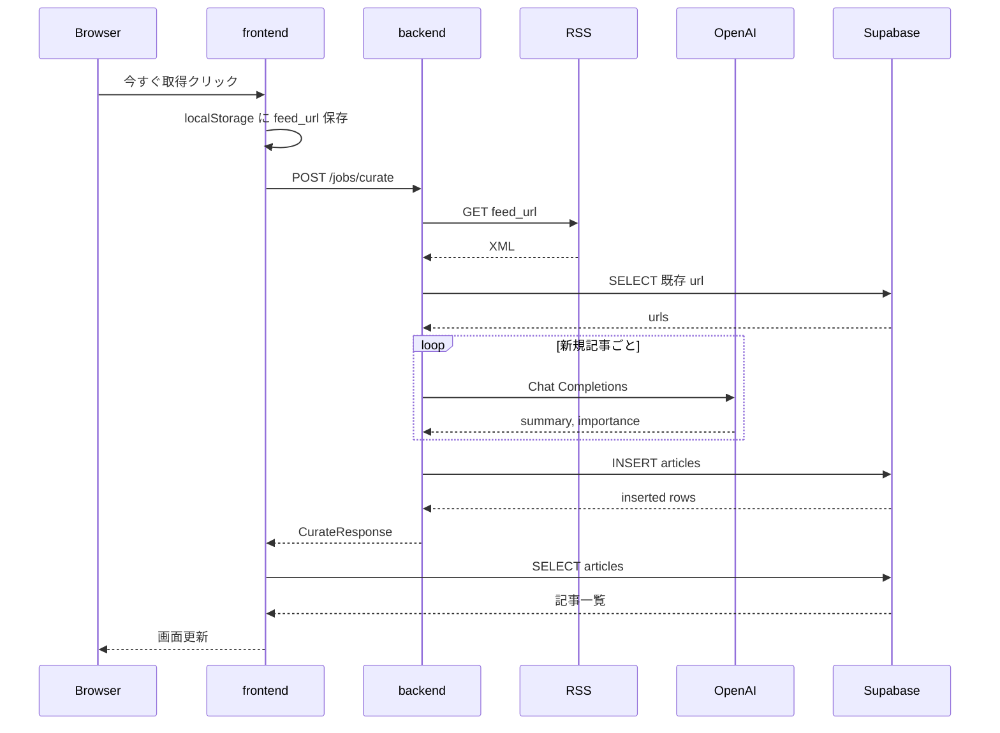
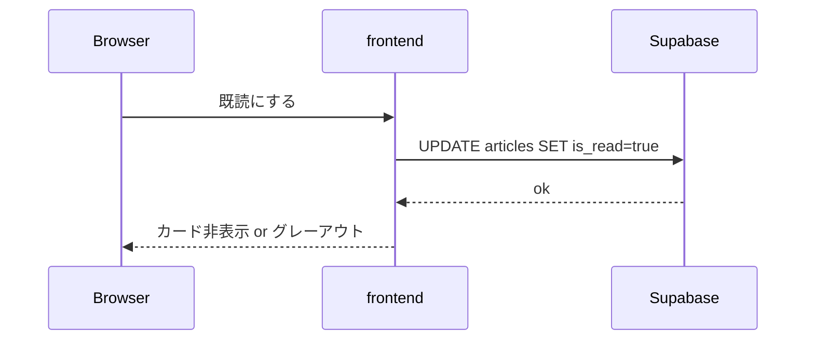

# ニュースデスク 詳細設計書

| 項目 | 内容 |
|------|------|
| 文書名 | 詳細設計書 |
| 対象システム | ニュースデスク（RSS キュレーションアプリ） |
| 版 | 0.1.0 |
| 根拠ソース | リポジトリ現行実装（`frontend/` / `backend/`） |
| 作成日 | 2026-10-15 |
| 関連 | [基本設計書](./基本設計書.md) |

---

## 1. はじめに

本書類は、基本設計をソースコード単位まで落とした**詳細設計**です。

たとえで言うと、「店の間取りだけでなく、どの棚に何を置き、どの手順で入庫するか」を書いた作業手順書です。

---

## 2. ディレクトリ構成

```text
RSS_App/
├── docs/                         … 設計書
│   ├── 基本設計書.md
│   └── 詳細設計書.md
├── frontend/                     … Next.js 画面
│   ├── app/
│   │   ├── layout.tsx            … 全体レイアウト・フォント
│   │   ├── page.tsx              … ダッシュボード本体
│   │   └── globals.css
│   ├── components/ui/            … shadcn/ui 部品
│   ├── lib/
│   │   ├── supabase/client.ts    … Supabase クライアント（anon）
│   │   ├── supabase/types.ts     … 型・重要度変換
│   │   ├── backend.ts            … キュレート API 呼出
│   │   └── feed-urls.ts          … RSS URL の localStorage
│   ├── .env.example
│   └── package.json
└── backend/                      … FastAPI
    ├── app/
    │   ├── main.py               … アプリ入口・CORS・/health
    │   ├── config.py             … 環境変数
    │   ├── routers/jobs.py       … POST /jobs/curate
    │   └── services/
    │       ├── curate.py         … パイプライン司令塔
    │       ├── rss.py            … RSS 取得
    │       ├── ai.py             … 要約・重要度
    │       └── supabase_writer.py… DB 書き込み
    ├── .env.example
    └── requirements.txt
```

---

## 3. 処理シーケンス

### 3.1 今すぐ取得（全体）



### 3.2 既読化



---

## 4. データベース詳細

### 4.1 topics

| 列名 | 必須 | 説明 | 操作元 |
|------|------|------|--------|
| id | ○ | 主キー（Supabase 既定 UUID 想定） | 自動 |
| name | ○ | トピック名 | frontend INSERT |
| created_at | ○ | 作成日時 | 自動（想定） |

**フロント読出:**

```text
select id, name, created_at
from topics
order by created_at asc
```

**フロント追加:**

```text
insert into topics (name) values (:name)
returning id, name, created_at
```

### 4.2 articles

| 列名 | 必須 | 説明 | 操作元 |
|------|------|------|--------|
| id | ○ | 主キー | 自動 |
| topic_id | ○ | 所属トピック | backend INSERT |
| title | ○ | タイトル | backend INSERT |
| url | ○ | 元 URL（重複判定キー） | backend INSERT |
| summary | | AI 要約 | backend INSERT |
| importance | | `high` / `medium` / `low` 等 | backend INSERT |
| is_read | ○ | 既読。新規は `false` | backend INSERT / frontend UPDATE |
| published_at | | 公開日時（ISO 8601） | backend INSERT |

**フロント読出:**

```text
select id, topic_id, title, url, summary, importance, is_read, published_at
from articles
where topic_id = :topic_id
order by published_at desc nulls last
```

**フロント既読:**

```text
update articles set is_read = true where id = :id
```

**バック重複確認:**

```text
select url from articles where topic_id = :topic_id
（1000件単位でページング）
```

**バック挿入行イメージ:**

```json
{
  "topic_id": "...",
  "title": "...",
  "url": "...",
  "summary": "...",
  "importance": "medium",
  "is_read": false,
  "published_at": "2026-10-09T04:05:00+00:00"
}
```

### 4.3 重要度の取り扱い

| 保存値（推奨） | 画面ラベル | バッジ色 |
|----------------|------------|----------|
| `high` | 高 | 赤 |
| `medium` | 中 | 黄 |
| `low` | 低 | グレー |

フロントは `高` / `中` / `低` や `mid` も受け付け、内部で上記3値に正規化する（`toImportanceLevel`）。

### 4.4 RLS（開発時の想定）

開発では次の操作が必要。

| テーブル | 操作 | 主な実行者 |
|----------|------|------------|
| topics | SELECT, INSERT | frontend (anon) |
| articles | SELECT, UPDATE | frontend (anon) |
| articles | SELECT, INSERT | backend (service_role ※RLS バイパス想定) |

本番では認証ユーザー単位などに絞ること。

---

## 5. バックエンド詳細

### 5.1 起動・設定

| 項目 | 値 |
|------|-----|
| エントリ | `uvicorn app.main:app --reload --port 8000` |
| 設定読込 | `backend/.env`（`pydantic-settings`） |
| CORS | `CORS_ORIGINS`（カンマ区切り、既定 `http://localhost:3000`） |

#### 環境変数

| 変数 | 必須 | 既定 | 説明 |
|------|------|------|------|
| `SUPABASE_URL` | 書込時 | 空 | Supabase URL |
| `SUPABASE_SERVICE_ROLE_KEY` | 書込時 | 空 | 秘密キー |
| `OPENAI_API_KEY` | 任意 | 空 | 未設定時は AI フォールバック |
| `OPENAI_MODEL` | 任意 | `gpt-4o-mini` | 利用モデル |
| `CORS_ORIGINS` | 任意 | `http://localhost:3000` | 許可オリジン |

実装: [`backend/app/config.py`](../backend/app/config.py)

### 5.2 API 仕様

#### 5.2.1 `GET /health`

**目的:** サーバー生存確認と設定状態の確認。

**レスポンス例:**

```json
{
  "status": "ok",
  "supabase_configured": true,
  "openai_configured": false,
  "openai_model": "gpt-4o-mini"
}
```

実装: [`backend/app/main.py`](../backend/app/main.py)

#### 5.2.2 `POST /jobs/curate`

**目的:** 1トピック分のキュレーションを手動実行する。

**リクエスト:**

```json
{
  "topic_id": "xxxxxxxx-xxxx-xxxx-xxxx-xxxxxxxxxxxx",
  "feed_url": "https://www.nasa.gov/rss/dyn/breaking_news.rss"
}
```

| フィールド | 型 | 必須 | 説明 |
|------------|----|------|------|
| topic_id | string | ○ | `topics.id` |
| feed_url | string | ○ | RSS / Atom URL |

**成功レスポンス（200）:**

```json
{
  "fetched": 10,
  "new_items": 3,
  "inserted": 3,
  "message": "RSS から 10 件取得し、新規 3 件、書き込み 3 件です。AI 要約 3 件。"
}
```

| フィールド | 説明 |
|------------|------|
| fetched | RSS から取れた件数 |
| new_items | DB に無かった件数 |
| inserted | 実際に INSERT した件数 |
| message | 人間向けの結果メモ |

**エラー:**

| 状況 | HTTP | detail |
|------|------|--------|
| RSS 取得・解析失敗 | 502 | `FeedFetchError` メッセージ |
| Supabase 書込失敗／未設定（書込時） | 502 | `SupabaseWriterError` メッセージ |
| バリデーション失敗 | 422 | FastAPI 標準 |

実装: [`backend/app/routers/jobs.py`](../backend/app/routers/jobs.py)

### 5.3 サービスモジュール

#### 5.3.1 `curate.py`（司令塔）

**関数:** `run_curation(topic_id: str, feed_url: str) -> CurateResult`

**処理手順:**

1. `rss.fetch_feed_items(feed_url)`  
2. `supabase_writer.list_existing_urls(topic_id)`  
3. 既存 URL を除いた `fresh` を作る  
4. 各件で `ai.enrich_article(title, raw_summary)`  
5. `ArticleDraft` に変換  
6. `supabase_writer.insert_articles(drafts)`  
7. 件数と AI 使用状況を含む `message` を返す  

実装: [`backend/app/services/curate.py`](../backend/app/services/curate.py)

#### 5.3.2 `rss.py`（RSS 取得）

**公開型:**

| 名前 | 内容 |
|------|------|
| `FeedItem` | `title`, `url`, `published_at`, `raw_summary` |
| `FeedFetchError` | 取得失敗例外 |

**関数:** `fetch_feed_items(feed_url, timeout=20.0) -> list[FeedItem]`

**詳細ルール:**

| 項目 | 仕様 |
|------|------|
| HTTP | httpx GET、リダイレクト追従、timeout 20s |
| User-Agent | `RSS-App-Curation/0.1 (+https://localhost; feed fetcher)` |
| パース | feedparser |
| 必須フィールド | title と link（url）が両方あること |
| 重複 | 同一フィード内 URL は1件にまとめる |
| 日付 | `published_parsed` / `updated_parsed` 優先、なければ文字列日付。UTC ISO 8601 |
| HTML | summary からタグ除去 |
| 失敗 | 空 URL・HTTP 失敗・entries 空・有効記事0件 → `FeedFetchError` |

実装: [`backend/app/services/rss.py`](../backend/app/services/rss.py)

#### 5.3.3 `ai.py`（要約・重要度）

**公開型:**

| 名前 | 内容 |
|------|------|
| `ArticleEnrichment` | `summary`, `importance`, `used_ai` |

**関数:** `enrich_article(title, content=None, settings=None) -> ArticleEnrichment`

**分岐:**

```text
OPENAI_API_KEY なし
  → フォールバック（content または title を短縮、importance=low, used_ai=false）

OPENAI_API_KEY あり
  → Chat Completions (JSON)
      成功 → summary / importance, used_ai=true
      失敗 → フォールバック（パイプラインは継続）
```

**OpenAI 呼び出し詳細:**

| 項目 | 値 |
|------|-----|
| URL | `https://api.openai.com/v1/chat/completions` |
| model | `settings.openai_model`（既定 `gpt-4o-mini`） |
| temperature | `0.2` |
| response_format | `json_object` |
| 入力上限 | 本文 4000 文字 |
| 要約上限 | 280 文字（超過時は末尾を `…`） |
| timeout | 45 秒 |

**期待 JSON:**

```json
{
  "summary": "日本語2〜3文",
  "importance": "high | medium | low"
}
```

**`normalize_importance`:** `高/中/低` や英語表記ゆれを `high/medium/low` に正規化。不明は `low`。

実装: [`backend/app/services/ai.py`](../backend/app/services/ai.py)

#### 5.3.4 `supabase_writer.py`（入庫）

**公開型:**

| 名前 | 内容 |
|------|------|
| `ArticleDraft` | 書き込み前の記事下書き |
| `SupabaseWriterError` | 書込系エラー |

**関数:**

| 関数 | 戻り値 | 仕様 |
|------|--------|------|
| `get_client()` | Client | URL/キー未設定なら例外 |
| `list_existing_urls(topic_id)` | `set[str]` | 未設定時は空集合。1000件ページング |
| `insert_articles(drafts)` | `int` | 挿入件数。未設定 or 空なら 0 |

**INSERT 前の除外条件:**

- title / url が空  
- 既存 URL  
- 同一バッチ内の重複 URL  
- 異なる `topic_id` が混在 → 例外  

実装: [`backend/app/services/supabase_writer.py`](../backend/app/services/supabase_writer.py)

---

## 6. フロントエンド詳細

### 6.1 画面モジュール

| ファイル | 役割 |
|----------|------|
| `app/layout.tsx` | `lang=ja`、Noto Sans JP、メタ情報 |
| `app/page.tsx` | ダッシュボード UI と状態管理（Client Component） |

### 6.2 状態（`HomePage`）

| state | 型 | 意味 |
|-------|-----|------|
| topics | Topic[] | トピック一覧 |
| articles | Article[] | 選択トピックの記事 |
| selectedTopicId | string \| null | 選択中トピック |
| topicsLoading / articlesLoading | boolean | 読込中 |
| savingTopic | boolean | トピック追加中 |
| readingId | string \| null | 既読更新中の記事 ID |
| showRead | boolean | 既読も表示するか |
| feedUrl | string | 入力中の RSS URL |
| curating | boolean | 今すぐ取得の実行中 |
| articlesRefreshKey | number | 取得後の再読込トリガ |
| message | string \| null | 上部メッセージ |

**導出値:**

- `visibleArticles` … `showRead` が false なら `is_read=false` のみ  
- `unreadCount` … 未読件数  

### 6.3 UI 配置詳細

#### 左ペイン

| 要素 | 仕様 |
|------|------|
| トピックボタン | 選択中は primary 色。クリックで記事を切替＆ feedUrl 復元 |
| 追加フォーム | `name` 入力 → topics INSERT → 選択状態を新規へ |

#### 右ペイン

| 要素 | 仕様 |
|------|------|
| 見出し | トピック名 ＋ 未読件数 |
| 既読トグル | 「既読を表示／隠す」 |
| RSS URL 入力 | 変更のたびに localStorage へ保存 |
| 今すぐ取得 | `runCurateJob` 実行。中はスピナー |
| 記事カード | 重要度バッジ、公開日、タイトルリンク、AI要約、既読ボタン |

#### 記事カード表示ルール

| 項目 | ルール |
|------|--------|
| 公開日 | `ja-JP` の日時。不正・null は「日付なし」 |
| 要約なし | 「要約はまだありません。」 |
| 既読表示時 | `opacity` 低下でグレーアウト |
| 既読ボタン | 既読済み／更新中は disabled |

### 6.4 ライブラリ詳細

#### `lib/supabase/client.ts`

- `NEXT_PUBLIC_SUPABASE_URL` / `ANON_KEY` が両方あるときのみクライアント生成  
- 無いときは `supabase = null`、`isSupabaseConfigured = false`  

#### `lib/backend.ts`

- ベース URL: `NEXT_PUBLIC_BACKEND_URL`（省略時 `http://localhost:8000`）  
- `POST /jobs/curate`  
- 失敗時は `detail` 文字列（または配列）を Error メッセージ化  

#### `lib/feed-urls.ts`

| 項目 | 値 |
|------|-----|
| storage key | `rss-app.topic-feed-urls` |
| 形式 | `{ [topicId: string]: string }` |
| API | `getFeedUrl` / `setFeedUrl` |

### 6.5 フロント環境変数

| 変数 | 必須 | 既定 | 説明 |
|------|------|------|------|
| `NEXT_PUBLIC_SUPABASE_URL` | ○ | なし | Supabase URL |
| `NEXT_PUBLIC_SUPABASE_ANON_KEY` | ○ | なし | anon key |
| `NEXT_PUBLIC_BACKEND_URL` | 任意 | `http://localhost:8000` | バックエンド |

---

## 7. エラー処理一覧

| 発生箇所 | 条件 | ユーザーへの見え方 |
|----------|------|--------------------|
| frontend 起動時 | Supabase 未設定 | 上部に設定案内。追加ボタン無効 |
| topics 読込 | RLS / 表名ミス | 「トピックを読み込めませんでした…」 |
| articles 読込 | 同上 | 「記事を読み込めませんでした…」 |
| トピック追加 | INSERT 失敗 | 「トピックを追加できませんでした…」 |
| 既読 | UPDATE 失敗 | 「既読に更新できませんでした…」 |
| 今すぐ取得 | feed_url 空 | URL 入力を促す |
| 今すぐ取得 | バック未起動等 | fetch 失敗メッセージ |
| 今すぐ取得 | 502 | バックの detail を表示 |
| RSS | 取得失敗 | API 502 |
| AI | キー無し／失敗 | フォールバック要約で継続（止まらない） |
| Supabase 書込 | 未設定／失敗 | API 502（未設定で draft 空相当なら inserted=0 の場合あり） |

---

## 8. 定数・閾値

| 定数 | 値 | 場所 |
|------|-----|------|
| RSS timeout | 20 秒 | `rss.py` |
| OpenAI timeout | 45 秒 | `ai.py` |
| 入力本文上限 | 4000 文字 | `ai.py` |
| 要約文字上限 | 280 文字 | `ai.py` |
| URL 取得ページサイズ | 1000 | `supabase_writer.py` |
| フロント開発ポート | 3000 | Next.js 既定 |
| バック開発ポート | 8000 | uvicorn 起動引数 |

---

## 9. 依存パッケージ（主要）

### frontend

| パッケージ | 用途 |
|------------|------|
| next / react / react-dom | アプリ基盤 |
| @supabase/supabase-js | DB アクセス |
| lucide-react | アイコン |
| shadcn / @base-ui/react / tailwind | UI |

### backend

| パッケージ | 用途 |
|------------|------|
| fastapi / uvicorn | API サーバー |
| httpx | HTTP クライアント（RSS・OpenAI） |
| feedparser | RSS/Atom パース |
| supabase | DB クライアント |
| pydantic-settings | 設定 |

---

## 10. テスト観点（詳細）

| No | 観点 | 手順の要点 | 期待 |
|----|------|------------|------|
| T-01 | ヘルス | `GET /health` | `status=ok` |
| T-02 | RSS 単体 | NASA 等の公開フィードで `fetch_feed_items` | 件数 > 0、url が http |
| T-03 | AI フォールバック | OpenAI キー無しで enrich | used_ai=false, importance=low |
| T-04 | 重複排除 | 同じ feed で2回 curate | 2回目 inserted=0 近傍 |
| T-05 | 画面取得 | トピック選択→URL→今すぐ取得 | 記事カードが増える |
| T-06 | 既読 | 既読ボタン | 未読一覧から消える |
| T-07 | 既読表示 | トグル ON | グレーで残る |
| T-08 | CORS | フロントから POST | ブラウザでブロックされない |
| T-09 | 秘密鍵 | frontend バンドルに service_role が無い | 含まれない |

---

## 11. 変更時の注意

1. DB 列を変えたら `frontend/lib/supabase/types.ts` と本書類を同時更新する  
2. API レスポンス形を変えたら `frontend/lib/backend.ts` も合わせる  
3. `service_role` をフロント環境変数に移さない  
4. RSS URL を DB 化するときは `feed-urls.ts` と画面入力の責務を見直す  

---

## 12. 改訂履歴

| 版 | 日付 | 内容 |
|----|------|------|
| 0.1.0 | 2026-10-15 | 現行ソースに基づき初版作成 |
